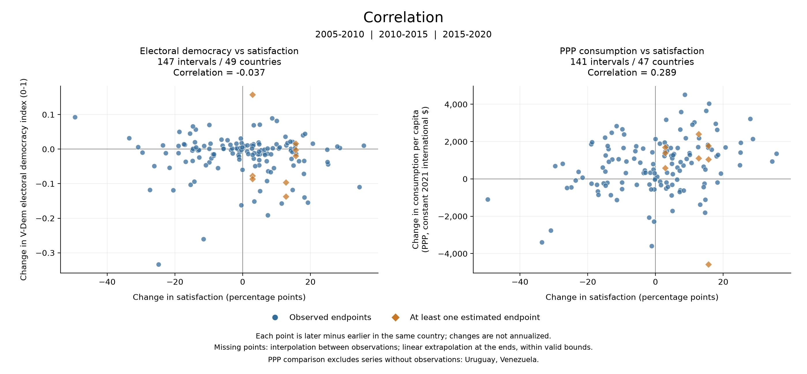

# Five-year change correlations

Run in PowerShell:

```powershell
.\venv\Scripts\python.exe correlation.py
```

Install `requirements.txt` in a fresh Python environment. Excel input uses
pandas with `openpyxl`, which is included in the requirements.

The script writes one image, `output/correlation.jpg`, with two panels:

- Changes in V-Dem electoral democracy against changes in satisfaction.
- Changes in PPP consumption per capita against changes in satisfaction.



Satisfaction changes are on the horizontal axis in both panels. Each point is
one country's later value minus its earlier value over 2005–2010, 2010–2015, or
2015–2020. Changes are in the original units, without annualization. Each panel
reports only the Pearson coefficient, labeled “Correlation”, and its own sample size.

## Inputs and scales

The four files in `data/` are read only:

- `eurobarometer_country_year_satisdms.csv`: individual responses, aggregated to
  the unweighted percentage satisfied in each country/year. Codes 1 and 2 count
  as satisfied; 3 and 4 as dissatisfied. A zero is a missing-year placeholder,
  excluded from response counts. Survey weights are unavailable in this extract.
- `Jamovi_Models1_3_Data.xlsx`: Latin American country/year satisfaction
  percentages, using `Satisfaction`. A missing or zero `Satisfaction_N` marks a
  missing observation. A satisfaction percentage of zero with a positive sample
  count remains a valid observation.
- `V-Dem-CY-Core-v16.csv`: `v2x_polyarchy`, an expert-based electoral democracy
  index on a 0–1 scale. This is the democracy measure selected for the analysis;
  it does not measure citizens' perceptions of democraticness.
- `API_NE.CON.PCAP.PP.KD_DS2_en_csv_v2_84798.csv`: World Bank indicator
  `NE.CON.PCAP.PP.KD`, household and NPISH consumption per capita at PPP in
  constant 2021 international dollars. This measures consumption, rather than GDP.

The survey sources are combined by country code. Country names such as Czech
Republic, Macedonia (FYROM), and Turkey are mapped to their corresponding codes.
Great Britain uses UK-wide national indicators (`GBR`). Northern Ireland and
Cyprus (TCC) are excluded from the
analysis because these files have no separate national indicators for them.
Their input rows remain untouched.

## Missing observations

Before calculating changes, the script constructs the four-year grid for each
survey country and estimates missing measurements separately within that country:

- Interior gaps use linear interpolation between the nearest observed years.
- Missing endpoints use linear extrapolation from the nearest two observed years.
- A series with only one observed point uses a constant estimate.
- An entirely missing series stays missing. Its intervals are excluded only from
  comparisons needing that series. In the current inputs, Uruguay and Venezuela
  remain in the democracy comparison and are excluded from the PPP comparison.

Estimated satisfaction is bounded to 0–100%, democracy to 0–1, and consumption
to nonnegative values. Observed values are never changed. Estimates use original
observations as anchors, never other estimates or other countries' values.

Estimated endpoints are tracked in memory, with their method and any clipping.
Orange diamonds in the image identify intervals using at least one estimate;
blue circles identify intervals with observed endpoints. The console reports
estimation counts, exclusions, and correlation results. No corrected input data
or extra report files are written.

These are descriptive correlations. Intervals can share endpoints, and the
analysis does not control for regional or time effects. Estimates add uncertainty;
correlation does not establish causation. A coefficient is unavailable for a
constant series or fewer than three complete intervals.

## Other ways to run

Check calculations without creating output:

```powershell
.\venv\Scripts\python.exe correlation.py --dry-run
```

Choose the JPG destination:

```powershell
.\venv\Scripts\python.exe correlation.py --output output/comparison.jpg
```

Input overrides are available through `--eurobarometer`, `--latin-america`,
`--vdem`, and `--ppp`. Run with `--help` to see their defaults. Test images can be
written to a temporary directory and removed after inspection.

## Data sources and acknowledgements

This project gratefully acknowledges the organisations and survey participants
whose work makes the analysis possible:

- [Eurobarometer](https://europa.eu/eurobarometer/): the original European survey
  responses on satisfaction with democracy used in the harmonised dataset.
- [Latinobarómetro](https://www.latinobarometro.org/): the Latin American survey
  data on satisfaction with democracy used in the country/year workbook.
- [World Bank — World Development Indicators](https://data.worldbank.org/indicator/NE.CON.PCAP.PP.KD):
  PPP-adjusted consumption per capita, indicator `NE.CON.PCAP.PP.KD`, expressed
  in constant 2021 international dollars.
- [V-Dem Institute — Varieties of Democracy](https://www.v-dem.net/data/the-v-dem-dataset/):
  the Country-Year Core v16 dataset and electoral democracy index
  (`v2x_polyarchy`). Dataset citation: Coppedge et al. (2026),
  [V-Dem [Country-Year/Country-Date] Dataset v16](https://doi.org/10.23696/vdemds26).

Please consult these providers' documentation for their original methods and
dataset citation guidance. Input datasets are kept locally and are excluded
from this repository.

## Git tracking

Only `correlation.py`, `README.md`, `requirements.txt`, `.gitignore`, and the
final image `output/correlation.jpg` are allowed into Git. Input datasets in
`data/`, other generated files in `output/`, virtual environments, and all other
files are ignored and must stay local. Supply the datasets locally before
running the script. To track another file, first add its exact path to the
allowlist in `.gitignore`.
